# similar-products-api

[English](README.md)

Servicio Spring Boot que expone `GET /product/{productId}/similar` en el puerto **5000**: devuelve el detalle de los
productos similares a uno dado, **ordenados por similitud**, agregando dos APIs existentes
(`/product/{id}/similarids` y `/product/{id}`).

Solución a la prueba técnica de backend (contrato: [`similarProducts.yaml`](src/main/resources/static/openapi/similarProducts.yaml),
copiado sin cambios).

## Ejecutar

Requisitos: Java 21 (el wrapper de Maven descarga Maven) o Docker.

1. Arrancar los mocks y la monitorización de la prueba, desde la carpeta de la prueba (sus ficheros no se modifican):

   ```bash
   docker-compose up -d simulado influxdb grafana
   ```

2. Arrancar la app, en el host o en Docker:

   ```bash
   ./mvnw spring-boot:run          # host: API de productos en http://localhost:3001
   docker compose up -d --build    # Docker: compose de este repo, API de productos vía host.docker.internal:3001
   ```

3. Probar: `curl localhost:5000/product/1/similar`. Swagger UI: <http://localhost:5000/swagger-ui/index.html>.

4. Lanzar la prueba de carga oficial, desde la carpeta de la prueba:

   ```bash
   docker-compose run --rm k6 run scripts/test.js
   ```

## Arquitectura

```mermaid
flowchart LR
    client([Cliente]) -->|GET /product/id/similar| controller[SimilarProductsController<br/>implementa ProductApi generada]
    controller --> service[SimilarProductsService<br/>dedupe, consultas en paralelo, orden de similitud]
    service --> client2[ProductClient]
    service -. un hilo virtual por detalle .-> client2
    client2 --> cache[(Caché Caffeine<br/>incluye 404)]
    cache -->|fallo de caché| cb{{Circuit breaker<br/>por endpoint}}
    cb --> http[RestClient + HttpClient del JDK<br/>read timeout 3 s]
    http --> upstream[(API de productos :3001)]
```



Paquetes (por responsabilidad, hexagonal ligera):

| Paquete | Contenido |
|---|---|
| `api` | Controlador que implementa la interfaz generada; manejador de excepciones con Problem Details (RFC 9457) |
| `application` | `SimilarProductsService`: ids, después detalles en paralelo, recogidos en el orden original |
| `domain` | Record `ProductDetail` y excepciones de dominio |
| `infrastructure` | `ProductClient`: llamadas HTTP, circuit breakers, caché, traducción de errores |
| `config` | Timeouts del cliente HTTP, executor de hilos virtuales, caché |

## Comportamiento

| Situación | Respuesta |
|---|---|
| Todos los similares disponibles | `200`, detalles en orden de similitud |
| Un similar devuelve 404 o 5xx | `200` sin ese producto |
| Un similar tarda más de 3 s | `200` sin ese producto, en unos 3 s como máximo |
| El producto pedido no existe | `404` (Problem Detail) |
| Ids similares no disponibles (5xx, timeout, circuito abierto) | `503` (Problem Detail), fuera del contrato, ver ADR 2 |
| Ids similares duplicados | Se eliminan, conservando la primera posición |

## Decisiones de diseño

Resumen en [docs/DECISIONS.es.md](docs/DECISIONS.es.md); cada una tiene un ADR en [docs/adr](docs/adr) con contexto,
opciones y consecuencias. En breve:

- **Spring MVC + hilos virtuales** en lugar de WebFlux: misma escalabilidad para esta I/O bloqueante, código imperativo.
- **Resultados parciales**: un similar que falla se omite; el resto se devuelve en orden.
- **Timeout de 3 s por detalle**, aplicado por el cliente HTTP: los productos 1000 (5 s) y 10000 (50 s) quedan fuera a propósito.
- **Circuit breaker sin reintentos**: reintentar contra un servicio lento bajo carga solo añade carga.
- **Caché Caffeine con caché negativa** delante del circuit breaker.
- **OpenAPI-first**: la compilación falla si el controlador se separa del contrato.

## Cómo se ha probado

- **37 tests automáticos** (`./mvnw verify`), en tres capas:

  | Capa | Tests | Qué cubren |
  |---|---|---|
  | Unitarios (JUnit 5 + Mockito, sin Spring) | `SimilarProductsServiceTest` (7) | Orden de similitud cuando un producto anterior responde el último, deduplicación, omisión ante 404/fallo, timeout de seguridad, lista vacía, propagación del 404 |
  | Slice web (`@WebMvcTest`) | `SimilarProductsControllerTest` (3) | Formato JSON del contrato y orden, Problem Details 404 y 503 (sin filtrar mensajes internos) |
  | Integración (Spring Boot + WireMock como API de productos) | `ProductClientTest`, `ProductClientCacheTest`, `ProductClientCircuitBreakerTest`, `SimilarProductsEndpointTest`, `OperationalEndpointsTest` (26) | HTTP real: ids numéricos, traducción de 404/500/timeout, paralelismo, resultados parciales, 503, apertura del circuit breaker (y que no se abra con 404), caché de detalles, ids y 404, no cachear fallos, health, métricas, Swagger UI |

  Los unitarios prueban la lógica de orquestación aislada; los de integración, lo que solo aparece con HTTP real
  (timeouts, rarezas del API externo, cableado de caché y breaker). Los unitarios y los de la capa web se comprobaron
  contra errores introducidos a propósito (quitar la deduplicación, el timeout de seguridad o el manejo de fallos,
  invertir el orden, filtrar el mensaje interno del error): cada error hizo fallar al menos un test.
- **Comprobaciones manuales** contra los mocks reales, con la app en Docker: `/product/1` devuelve 2, 3, 4 en orden;
  `/product/4` y `/product/5` devuelven 1, 2; `/product/2` devuelve 3, 100 en unos 3 s; `/product/3` devuelve 100;
  `/product/99` devuelve 404.
- **Prueba k6 oficial** (app en Docker en un portátil): 19.927 peticiones, todas `200`, p95 13 ms, media 8,9 ms,
  máximo 3 s (el timeout de detalle).


Cómo leerlo: los cinco escenarios se ejecutan uno tras otro a ~400 req/s. Los tiempos se quedan en pocos
milisegundos porque, tras las primeras peticiones, los productos salen de la caché y el circuito abierto descarta
los productos lentos 1000 y 10000 sin esperar. Los picos de 3 s al final de "slow" y "verySlow" son una media sobre muy
pocas peticiones: cuando paran los usuarios virtuales, las únicas que aún terminan son las que llegaron a los
productos lentos (por ejemplo cuando el circuito vuelve a probar) y esperaron al timeout de 3 s. Las "interrupted iterations"
de la salida de k6 las provoca `gracefulStop: 0s` en el script de la prueba, no son errores.

## Limitaciones conocidas

- La caché es por instancia; con varias instancias cada una calienta la suya (el siguiente paso sería una caché compartida).
- Mientras el circuito de detalle está abierto, un producto sano no cacheado también se omite, durante hasta 5 s (ADR 4).
- La respuesta no indica que se ha omitido un producto; solo aparece en logs de debug y métricas.
- Precio y disponibilidad pueden tener hasta 5 minutos de antigüedad (TTL de la caché, configurable).

## Configuración

| Propiedad | Valor por defecto | Significado |
|---|---|---|
| `product-api.base-url` (`PRODUCT_API_BASE_URL`) | `http://localhost:3001` | Raíz del API de productos |
| `product-api.connect-timeout` | `1s` | Timeout de conexión TCP |
| `product-api.read-timeout` | `3s` | Tiempo por llamada antes de omitir el producto |
| `similar-products.lookup-timeout` | `4s` | Red de seguridad por consulta de detalle |
| `spring.cache.caffeine.spec` | `maximumSize=10000,expireAfterWrite=5m,recordStats` | Tamaño y TTL de la caché |
| `resilience4j.circuitbreaker.*` | ver `application.yml` | Umbrales del circuit breaker |

Operación: `/actuator/health` (incluye el estado de los circuit breakers), `/actuator/metrics`, `/actuator/caches`,
`/actuator/circuitbreakers`.

## Desarrollo asistido por IA

Este servicio se ha construido con **Claude Code** (Anthropic) como programador en pareja, a partir de un plan escrito
que fijaba de antemano el stack y las decisiones no negociables (sin reintentos, timeout de 3 s, resultados
parciales, MVC con hilos virtuales).

- **Qué hizo la IA**: generó el código y los tests guiado por tests (cada test se vio fallar antes de implementar),
  comprobó con `curl` el comportamiento real de los mocks antes de programar, lanzó la prueba k6 oficial, capturó el
  dashboard de Grafana con Chrome DevTools y redactó la documentación.
- **Qué se validó a mano**: las decisiones de diseño y sus contrapartidas, los resultados de k6 y el dashboard, y cada
  línea de este README y de los ADRs.
- **Guardarraíles**: la suite de tests automáticos, la prueba k6 oficial, CI en cada push y una interfaz generada
  desde el contrato que rompe la compilación si el API se desvía.
