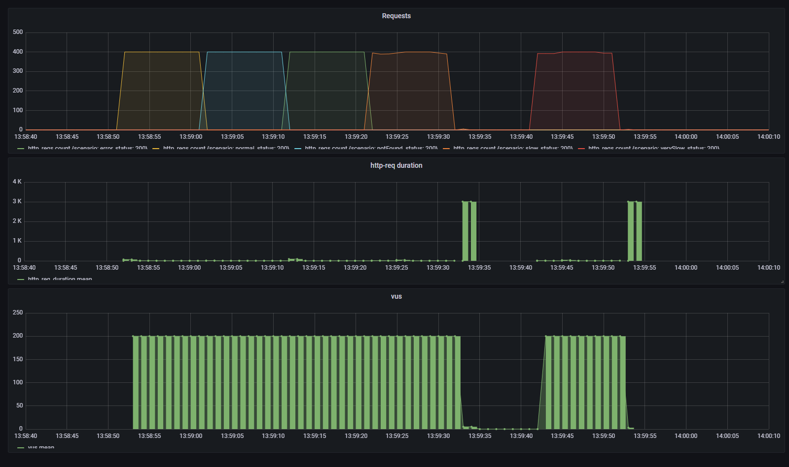
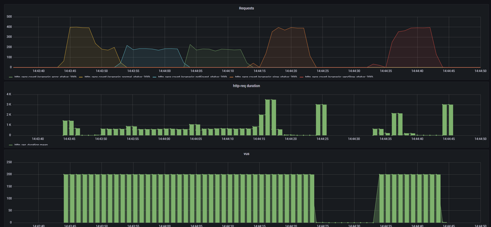

# similar-products-api

[English](README.md)

Servicio Spring Boot que expone `GET /product/{productId}/similar` en el puerto **5000**: devuelve el detalle de los
productos similares a uno dado, **ordenados por similitud**, agregando dos APIs existentes
(`/product/{id}/similarids` y `/product/{id}`).

Solución a la prueba técnica de backend (contrato: [`similarProducts.yaml`](src/main/resources/static/openapi/similarProducts.yaml),
copiado sin cambios).

## Ejecutar

Requisitos: Java 21 (el wrapper de Maven descarga Maven) o Docker.

1. Arrancar los mocks y la monitorización de la prueba, desde la carpeta de la prueba (sus ficheros no se modifican):

   ```bash
   docker-compose up -d simulado influxdb grafana
   ```

2. Arrancar la app, en el host o en Docker:

   ```bash
   ./mvnw spring-boot:run          # host: API de productos en http://localhost:3001
   docker compose up -d --build    # Docker: compose de este repo, API de productos vía host.docker.internal:3001
   ```

   Para arrancarla sin caché (ver "Prueba de carga"): `SPRING_CACHE_TYPE=none docker compose up -d` o
   `./mvnw spring-boot:run -Dspring-boot.run.arguments=--spring.cache.type=none`.

3. Probar: `curl localhost:5000/product/1/similar`. Swagger UI: <http://localhost:5000/swagger-ui/index.html>.

4. Lanzar la prueba de carga oficial, desde la carpeta de la prueba:

   ```bash
   docker-compose run --rm k6 run scripts/test.js
   ```

## Arquitectura

```mermaid
flowchart LR
    client([Cliente]) -->|GET /product/id/similar| controller[SimilarProductsController<br/>implementa ProductApi generada]
    controller --> service[SimilarProductsService<br/>dedupe, consultas en paralelo, orden de similitud]
    service --> client2[ProductClient]
    service -. un hilo virtual por detalle .-> client2
    client2 --> cache[(Caché Caffeine<br/>incluye 404)]
    cache -->|fallo de caché| cb{{Circuit breaker<br/>por endpoint}}
    cb --> bh{{Bulkhead<br/>máx. 500 en vuelo}}
    bh --> http[RestClient + HttpClient del JDK<br/>read timeout 3 s]
    http --> upstream[(API de productos :3001)]
```



Paquetes (por responsabilidad, hexagonal ligera):

| Paquete | Contenido |
|---|---|
| `api` | Controlador que implementa la interfaz generada; manejador de excepciones con Problem Details (RFC 9457) |
| `application` | `SimilarProductsService`: ids, después detalles en paralelo, recogidos en el orden original |
| `domain` | Record `ProductDetail`, excepciones de dominio y el port `ProductCatalog` del que depende el servicio |
| `infrastructure` | `ProductClient` (implementa `ProductCatalog`): llamadas HTTP, circuit breakers, bulkheads, caché, validación, traducción de errores |
| `config` | Timeouts del cliente HTTP, executor de hilos virtuales, caché, log del circuit breaker |

## Comportamiento

| Situación | Respuesta |
|---|---|
| Todos los similares disponibles | `200`, detalles en orden de similitud |
| Un similar devuelve 404 o 5xx | `200` sin ese producto |
| Un similar tarda más de 3 s | `200` sin ese producto, en unos 3 s como máximo; los 30 s siguientes se omite sin esperarlo |
| Un similar llega sin un campo obligatorio | `200` sin ese producto (reenviarlo rompería el contrato) |
| Demasiadas llamadas en vuelo al API de productos | `200` sin los productos que no consiguieron hueco en 200 ms |
| El producto pedido no existe | `404` (Problem Detail) |
| Ids similares no disponibles (5xx, timeout, circuito abierto) | `503` (Problem Detail, causa en el log), fuera del contrato, ver ADR 2 |
| Ids similares duplicados | Se eliminan, conservando la primera posición |

## Decisiones de diseño

Resumen en [docs/DECISIONS.es.md](docs/DECISIONS.es.md); cada una tiene un ADR en [docs/adr](docs/adr) con contexto,
opciones y consecuencias. En breve:

- **Spring MVC + hilos virtuales** en lugar de WebFlux: misma escalabilidad para esta I/O bloqueante, código imperativo.
- **Resultados parciales**: un similar que falla o llega incompleto se omite; el resto se devuelve en orden.
- **Timeout de 3 s por detalle**, aplicado por el cliente HTTP: los productos 1000 (5 s) y 10000 (50 s) quedan fuera a propósito.
- **Circuit breaker sin reintentos**: reintentar contra un servicio lento bajo carga solo añade carga.
- **Bulkhead**: con hilos virtuales esperar nos sale gratis, así que el API de productos necesita un límite explícito de llamadas en vuelo.
- **Caché Caffeine con caché negativa** delante del circuit breaker.
- **Productos lentos recordados 30 s**: un producto que dio timeout se omite sin volver a esperarlo.
- **OpenAPI-first**: la compilación falla si el controlador se separa del contrato.

## Cómo se ha probado

**51 tests automáticos** (`./mvnw verify`), en tres capas:

| Capa | Tests | Qué cubren |
|---|---|---|
| Unitarios (JUnit 5 + Mockito, sin Spring) | `SimilarProductsServiceTest` (7) | Orden de similitud cuando un producto anterior responde el último, deduplicación, omisión ante 404/fallo, timeout de seguridad, lista vacía, propagación del 404, métrica de omitidos |
| Slice web (`@WebMvcTest`) | `SimilarProductsControllerTest` (4) | Formato JSON del contrato y orden, Problem Details 404 y 503 (sin filtrar mensajes internos), causa del 503 en el log |
| Integración (Spring Boot + WireMock como API de productos) | `ProductClientTest`, `ProductClientCacheTest`, `ProductClientCircuitBreakerTest`, `ProductClientBulkheadTest`, `SimilarProductsEndpointTest`, `OperationalEndpointsTest`, test de arranque (40) | HTTP real: ids numéricos, traducción de 404/500/timeout, productos lentos omitidos tras un timeout (no tras un 5xx), detalles incompletos, paralelismo, resultados parciales, 503, apertura del circuit breaker (no con 404) y su log, bulkhead que rechaza por encima del límite sin abrir el circuito, caché de detalles, ids y 404, no cachear fallos, health, métricas, Swagger UI |

Los unitarios prueban la lógica de orquestación aislada; los de integración, lo que solo aparece con HTTP real
(timeouts, rarezas del API externo, cableado de caché, breaker y bulkhead). Los tests escritos para código que ya
existía se comprobaron contra errores introducidos a propósito (quitar la deduplicación, el timeout de seguridad o el
manejo de fallos, invertir el orden, filtrar el mensaje interno del error, dejar que los rechazos del bulkhead abran
el circuito): cada error hizo fallar al menos un test.

**Comprobaciones manuales** contra los mocks reales, con la app en Docker: `/product/1` devuelve 2, 3, 4 en orden;
`/product/4` y `/product/5` devuelven 1, 2; `/product/2` devuelve 3, 100 en unos 3 s, y en pocos milisegundos en la siguiente petición; `/product/3` devuelve 100;
`/product/99` devuelve 404.

### Prueba de carga (script k6 oficial, portátil, Docker Desktop en Windows)

| Ejecución | Peticiones | Errores | Media | p95 | Máx. |
|---|---|---|---|---|---|
| Con caché (por defecto), app en Docker | 19.740 | 0, todas `200` | 15 ms | 30 ms | 3,1 s |
| Sin caché, app en el host | 11.221 | 0, todas `200` | 397 ms | 1,56 s | 3,9 s |

**Con caché** (la configuración normal):



Los cinco escenarios se ejecutan uno tras otro a ~400 req/s. Los tiempos se quedan en pocos milisegundos porque, tras
las primeras peticiones, los productos salen de la caché y el circuito abierto descarta los productos lentos 1000 y
10000 sin esperar. Los picos de 3 s al final de "slow" y "verySlow" son una media sobre muy pocas peticiones: cuando
paran los usuarios virtuales, las únicas que aún terminan son las que llegaron a los productos lentos (por ejemplo
cuando el circuito vuelve a probar) y esperaron al timeout de 3 s. Las "interrupted iterations" de la salida de k6 las
provoca `gracefulStop: 0s` en el script de la prueba, no son errores.

**Sin caché**, para demostrar que el servicio aguanta por diseño y no solo gracias a la caché:



- Todas las peticiones siguen respondiendo `200` con los productos correctos. El circuit breaker se abrió y se volvió
  a cerrar solo durante los escenarios lentos (queda en el log como aviso).
- El throughput baja a ~180 req/s en los tres primeros escenarios porque **el cuello de botella es el propio mock**:
  sin caché, cada petición le hace cuatro llamadas. Cargando el mock directamente con el mismo patrón de llamadas y
  sin la app en medio (un script k6 aparte) se obtienen unas 600 llamadas/s y 300 ms de latencia media, que es lo que
  consigue el servicio. El servicio añade poco encima.
- Con la app dentro de Docker y sin caché, 14 de ~11.700 peticiones recibieron un `503`: abrir conexiones nuevas desde
  el contenedor de la app hasta el mock a través de `host.docker.internal` superó el timeout de conexión (1 s) con esa
  carga. Con la app en el host, y en todas las ejecuciones con caché, no hubo ninguno. La causa registrada en el log
  permitió encontrarlo rápido.

## Limitaciones conocidas

- La caché es por instancia; con varias instancias cada una calienta la suya (el siguiente paso sería una caché compartida).
- Mientras el circuito de detalle está abierto, un producto sano no cacheado también se omite, durante hasta 5 s (ADR 4).
- La respuesta no indica que se ha omitido un producto; aparece en la métrica `similar.products.left.out` y en los logs.
- Precio y disponibilidad pueden tener hasta 5 minutos de antigüedad (TTL de la caché, configurable).
- Un producto lento que se recupera sigue omitido hasta 30 s (ADR 8).
- El límite del bulkhead (500) está dimensionado para la prueba de carga, no para la capacidad de una dependencia real (ADR 7).

## Configuración

| Propiedad | Valor por defecto | Significado |
|---|---|---|
| `product-api.base-url` (`PRODUCT_API_BASE_URL`) | `http://localhost:3001` | Raíz del API de productos |
| `product-api.connect-timeout` | `1s` | Timeout de conexión TCP |
| `product-api.read-timeout` | `3s` | Tiempo por llamada antes de omitir el producto |
| `product-api.slow-product-ttl` | `30s` | Cuánto tiempo se omite un producto que dio timeout |
| `similar-products.lookup-timeout` | `4s` | Red de seguridad por consulta de detalle |
| `spring.cache.type` (`SPRING_CACHE_TYPE`) | `caffeine` | `none` desactiva la caché |
| `spring.cache.caffeine.spec` | `maximumSize=10000,expireAfterWrite=5m,recordStats` | Tamaño y TTL de la caché |
| `resilience4j.circuitbreaker.*` | ver `application.yml` | Umbrales del circuit breaker |
| `resilience4j.bulkhead.*` | 500 llamadas, 200 ms de espera | Llamadas en vuelo por endpoint |

Operación: `/actuator/health` (incluye el estado de los circuit breakers), `/actuator/metrics` (incluidas
`similar.products.left.out`, `cache.gets`, `resilience4j.*`), `/actuator/caches`, `/actuator/circuitbreakers`.
Se registran como aviso en el log: los cambios de estado del circuit breaker, los detalles incompletos del API de
productos y cada `503` con su causa.

## Desarrollo asistido por IA

Este servicio se ha construido con **Claude Code** (Anthropic) como programador en pareja, a partir de un plan escrito
que fijaba de antemano el stack y las decisiones no negociables (sin reintentos, timeout de 3 s, resultados
parciales, MVC con hilos virtuales).

- **Qué hizo la IA**: generó el código y los tests guiado por tests (cada test se vio fallar antes de implementar, o se
  comprobó contra un error introducido a propósito cuando el código ya existía), comprobó con `curl` el comportamiento
  real de los mocks antes de programar, lanzó la prueba k6 oficial con y sin caché, investigó los resultados (los
  `503` y el cuello de botella del mock descritos arriba), capturó los dashboards de Grafana con Chrome DevTools y
  redactó la documentación.
- **Qué se validó a mano**: las decisiones de diseño y sus contrapartidas, los resultados de k6 y los dashboards, y cada
  línea de este README y de los ADRs.
- **Guardarraíles**: la suite de tests automáticos, la prueba k6 oficial, CI en cada push y una interfaz generada
  desde el contrato que rompe la compilación si el API se desvía.
