# similar-products-api

[Español](README.es.md)

Spring Boot service that exposes `GET /product/{productId}/similar` on port **5000**: it returns the details of the
products similar to a given one, **ordered by similarity**, aggregating two existing APIs
(`/product/{id}/similarids` and `/product/{id}`).

Solution to the backend technical test (contract: [`similarProducts.yaml`](src/main/resources/static/openapi/similarProducts.yaml),
copied unchanged).

## Run

Requirements: Java 21 (the Maven wrapper downloads Maven) or Docker.

1. Start the exercise's mocks and monitoring, from the exercise folder (its files are not modified):

   ```bash
   docker-compose up -d simulado influxdb grafana
   ```

2. Start the app, either on the host or in Docker:

   ```bash
   ./mvnw spring-boot:run          # host: product API at http://localhost:3001
   docker compose up -d --build    # Docker: this repo's compose, product API through host.docker.internal:3001
   ```

   To run it without the cache (see "Load test"): `SPRING_CACHE_TYPE=none docker compose up -d` or
   `./mvnw spring-boot:run -Dspring-boot.run.arguments=--spring.cache.type=none`.

3. Try it: `curl localhost:5000/product/1/similar`. Swagger UI: <http://localhost:5000/swagger-ui/index.html>.

4. Run the official load test, from the exercise folder:

   ```bash
   docker-compose run --rm k6 run scripts/test.js
   ```

## Architecture

```mermaid
flowchart LR
    client([Client]) -->|GET /product/id/similar| controller[SimilarProductsController<br/>implements generated ProductApi]
    controller --> service[SimilarProductsService<br/>dedupe, parallel lookups, similarity order]
    service --> client2[ProductClient]
    service -. one virtual thread per detail .-> client2
    client2 --> cache[(Caffeine cache<br/>incl. 404)]
    cache -->|miss| cb{{Circuit breaker<br/>per endpoint}}
    cb --> bh{{Bulkhead<br/>max 500 in flight}}
    bh --> http[RestClient + JDK HttpClient<br/>3 s read timeout]
    http --> upstream[(Product API :3001)]
```



Packages (by responsibility, light hexagonal):

| Package | Content |
|---|---|
| `api` | Controller implementing the generated interface; exception handler producing RFC 9457 Problem Details |
| `application` | `SimilarProductsService`: ids, then details in parallel, collected in the original order |
| `domain` | `ProductDetail` record and domain exceptions |
| `infrastructure` | `ProductClient`: HTTP calls, circuit breakers, bulkheads, cache, validation, error translation |
| `config` | HTTP client timeouts, virtual-thread executor, caching, circuit breaker logging |

## Behaviour

| Situation | Response |
|---|---|
| All similar products available | `200`, details in similarity order |
| A similar product returns 404 or 5xx | `200` without that product |
| A similar product takes longer than 3 s | `200` without that product, answered in about 3 s at most |
| A similar product arrives without a required field | `200` without that product (forwarding it would break the contract) |
| Too many calls already in flight to the product API | `200` without the products that could not get a slot within 200 ms |
| Requested product does not exist | `404` (Problem Detail) |
| Similar ids unavailable (5xx, timeout, open circuit) | `503` (Problem Detail, cause logged), outside the contract, see ADR 2 |
| Duplicated similar ids | Deduplicated, first position kept |

## Design decisions

Summary in [docs/DECISIONS.md](docs/DECISIONS.md); each one has an ADR in [docs/adr](docs/adr) with context, options
and consequences. In short:

- **Spring MVC + virtual threads** instead of WebFlux: same scalability for this blocking I/O, imperative code.
- **Partial results**: a similar product that fails or arrives incomplete is left out; the rest are returned in order.
- **3 s timeout per detail**, enforced by the HTTP client: products 1000 (5 s) and 10000 (50 s) are left out on purpose.
- **Circuit breaker, no retry**: retrying against a slow service under load only adds load.
- **Bulkhead**: virtual threads make waiting free for us, so the product API needs an explicit cap on calls in flight.
- **Caffeine cache with negative caching** in front of the circuit breaker.
- **OpenAPI-first**: the build fails if the controller drifts from the contract.

## How it was tested

**47 automated tests** (`./mvnw verify`), in three layers:

| Layer | Tests | What they cover |
|---|---|---|
| Unit (JUnit 5 + Mockito, no Spring) | `SimilarProductsServiceTest` (7) | Similarity order when an earlier product answers last, deduplication, products left out on 404/failure, lookup safety timeout, empty list, 404 propagation, left-out metric |
| Web slice (`@WebMvcTest`) | `SimilarProductsControllerTest` (4) | Contract JSON format and order, 404 and 503 Problem Details (no internal messages leaked), 503 cause logged |
| Integration (Spring Boot + WireMock as the product API) | `ProductClientTest`, `ProductClientCacheTest`, `ProductClientCircuitBreakerTest`, `ProductClientBulkheadTest`, `SimilarProductsEndpointTest`, `OperationalEndpointsTest`, startup test (36) | Real HTTP: numeric ids, 404/500/timeout translation, incomplete details, parallelism, partial results, 503, circuit breaker opening (not on 404s) and its log, bulkhead rejecting beyond the cap without opening the circuit, caching of details, ids and 404s, no caching of failures, health, metrics, Swagger UI |

Unit tests check the orchestration logic in isolation; integration tests check what only shows up over real HTTP
(timeouts, upstream quirks, cache, breaker and bulkhead wiring). Tests written for code that already existed were
checked against deliberate bugs (removing deduplication, the safety timeout or the failure handling, reversing the
order, leaking the internal error message, letting bulkhead rejections open the circuit): each bug made at least one
test fail.

**Manual checks** against the real mocks, with the app in Docker: `/product/1` returns 2, 3, 4 in order;
`/product/4` and `/product/5` return 1, 2; `/product/2` returns 3, 100 in about 3 s; `/product/3` returns 100;
`/product/99` returns 404.

### Load test (official k6 script, laptop, Docker Desktop on Windows)

| Run | Requests | Errors | Mean | p95 | Max |
|---|---|---|---|---|---|
| With cache (default), app in Docker | 19,740 | 0, all `200` | 15 ms | 30 ms | 3.1 s |
| Without cache, app on the host | 11,221 | 0, all `200` | 397 ms | 1.56 s | 3.9 s |

**With cache** (the normal configuration):


The five scenarios run one after another at ~400 req/s. Response times stay at a few milliseconds because, after the
first requests, products come from the cache and the open circuit drops the slow products 1000 and 10000 without
waiting. The 3 s spikes at the end of "slow" and "verySlow" are a mean over very few requests: once the virtual users
stop, the only requests still finishing are the ones that reached the slow products (for example when the circuit
probes again) and waited for the 3 s timeout. The "interrupted iterations" in the k6 output come from
`gracefulStop: 0s` in the test script, not from errors.

**Without cache**, to show the service holds up by design and not only thanks to the cache:


- Every request still answers `200` with the right products. The circuit breaker opened and closed again on its own
  during the slow scenarios (logged as warnings).
- Throughput drops to ~180 req/s in the first three scenarios because **the mock itself is the bottleneck**: without
  cache, each request makes four calls to it. Loading the mock directly with the same call pattern and no app in
  between (a separate k6 script) gives about 600 calls/s and a 300 ms mean latency, which matches what the service
  achieves. The service adds little on top.
- With the app inside Docker and no cache, 14 of ~11,700 requests got a `503`: opening new connections from the app
  container to the mock through `host.docker.internal` timed out (1 s connect timeout) under that load. With the app
  on the host, and in every run with the cache, there were none. The logged cause made this easy to find.

## Known limitations

- The cache is per instance; several instances would each warm their own (a shared cache would be the next step).
- While the detail circuit is open, an uncached healthy product is also left out, for up to 5 s (ADR 4).
- The response does not say that a product was left out; it shows up in the `similar.products.left.out` metric and in
  the logs.
- Prices and availability can be up to 5 minutes stale (cache TTL, configurable).
- The bulkhead limit (500) is sized for the load test, not for a real dependency's capacity (ADR 7).

## Configuration

| Property | Default | Meaning |
|---|---|---|
| `product-api.base-url` (`PRODUCT_API_BASE_URL`) | `http://localhost:3001` | Product API root |
| `product-api.connect-timeout` | `1s` | TCP connect timeout |
| `product-api.read-timeout` | `3s` | Time allowed per call before the product is left out |
| `similar-products.lookup-timeout` | `4s` | Safety net per detail lookup |
| `spring.cache.type` (`SPRING_CACHE_TYPE`) | `caffeine` | `none` disables the cache |
| `spring.cache.caffeine.spec` | `maximumSize=10000,expireAfterWrite=5m,recordStats` | Cache size and TTL |
| `resilience4j.circuitbreaker.*` | see `application.yml` | Circuit breaker thresholds |
| `resilience4j.bulkhead.*` | 500 calls, 200 ms wait | Calls in flight per endpoint |

Operations: `/actuator/health` (includes circuit breaker state), `/actuator/metrics` (including
`similar.products.left.out`, `cache.gets`, `resilience4j.*`), `/actuator/caches`, `/actuator/circuitbreakers`.
Logged as warnings: circuit breaker state changes, incomplete details from the product API, and every `503` with its
cause.

## AI-assisted development

This service was built with **Claude Code** (Anthropic) as a pair programmer, working from a written plan that set
the stack and the non-negotiable decisions beforehand (no retry, 3 s timeout, partial results, MVC with virtual
threads).

- **What the AI did**: generated the code and tests test-first (each test was seen failing before the implementation,
  or checked against a deliberate bug when the code already existed), checked the real behaviour of the mocks with
  `curl` before coding, ran the official k6 test with and without cache, investigated the results (the `503`s and the
  mock bottleneck above), captured the Grafana dashboards with Chrome DevTools, and drafted the documentation.
- **What was validated by hand**: the design decisions and their trade-offs, the k6 results and the dashboards, and
  every line of this README and the ADRs.
- **Guardrails**: the automated test suite, the official k6 test, CI on every push, and a contract-generated
  interface that breaks the build if the API drifts.
