# similar-products-api

[Español](README.es.md)

Spring Boot service that exposes `GET /product/{productId}/similar` on port **5000**: it returns the details of the
products similar to a given one, **ordered by similarity**, aggregating two existing APIs
(`/product/{id}/similarids` and `/product/{id}`).

Solution to the backend technical test (contract: [`similarProducts.yaml`](src/main/resources/static/openapi/similarProducts.yaml),
copied unchanged).

## Run

Requirements: Java 21 (the Maven wrapper downloads Maven) or Docker.

1. Start the exercise's mocks and monitoring, from the exercise folder (its files are not modified):

   ```bash
   docker-compose up -d simulado influxdb grafana
   ```

2. Start the app, either on the host or in Docker:

   ```bash
   ./mvnw spring-boot:run          # host: product API at http://localhost:3001
   docker compose up -d --build    # Docker: this repo's compose, product API through host.docker.internal:3001
   ```

3. Try it: `curl localhost:5000/product/1/similar`. Swagger UI: <http://localhost:5000/swagger-ui/index.html>.

4. Run the official load test, from the exercise folder:

   ```bash
   docker-compose run --rm k6 run scripts/test.js
   ```

## Architecture

```mermaid
flowchart LR
    client([Client]) -->|GET /product/id/similar| controller[SimilarProductsController<br/>implements generated ProductApi]
    controller --> service[SimilarProductsService<br/>dedupe, parallel lookups, similarity order]
    service --> client2[ProductClient]
    service -. one virtual thread per detail .-> client2
    client2 --> cache[(Caffeine cache<br/>incl. 404)]
    cache -->|miss| cb{{Circuit breaker<br/>per endpoint}}
    cb --> http[RestClient + JDK HttpClient<br/>3 s read timeout]
    http --> upstream[(Product API :3001)]
```



Packages (by responsibility, light hexagonal):

| Package | Content |
|---|---|
| `api` | Controller implementing the generated interface; exception handler producing RFC 9457 Problem Details |
| `application` | `SimilarProductsService`: ids, then details in parallel, collected in the original order |
| `domain` | `ProductDetail` record and domain exceptions |
| `infrastructure` | `ProductClient`: HTTP calls, circuit breakers, cache, error translation |
| `config` | HTTP client timeouts, virtual-thread executor, caching |

## Behaviour

| Situation | Response |
|---|---|
| All similar products available | `200`, details in similarity order |
| A similar product returns 404 or 5xx | `200` without that product |
| A similar product takes longer than 3 s | `200` without that product, answered in about 3 s at most |
| Requested product does not exist | `404` (Problem Detail) |
| Similar ids unavailable (5xx, timeout, open circuit) | `503` (Problem Detail), outside the contract, see ADR 2 |
| Duplicated similar ids | Deduplicated, first position kept |

## Design decisions

Summary in [docs/DECISIONS.md](docs/DECISIONS.md); each one has an ADR in [docs/adr](docs/adr) with context, options
and consequences. In short:

- **Spring MVC + virtual threads** instead of WebFlux: same scalability for this blocking I/O, imperative code.
- **Partial results**: a similar product that fails is left out; the rest are returned in order.
- **3 s timeout per detail**, enforced by the HTTP client: products 1000 (5 s) and 10000 (50 s) are left out on purpose.
- **Circuit breaker, no retry**: retrying against a slow service under load only adds load.
- **Caffeine cache with negative caching** in front of the circuit breaker.
- **OpenAPI-first**: the build fails if the controller drifts from the contract.

## How it was tested

- **37 automated tests** (`./mvnw verify`), in three layers:

  | Layer | Tests | What they cover |
  |---|---|---|
  | Unit (JUnit 5 + Mockito, no Spring) | `SimilarProductsServiceTest` (7) | Similarity order when an earlier product answers last, deduplication, products left out on 404/failure, lookup safety timeout, empty list, 404 propagation |
  | Web slice (`@WebMvcTest`) | `SimilarProductsControllerTest` (3) | Contract JSON format and order, 404 and 503 Problem Details (no internal messages leaked) |
  | Integration (Spring Boot + WireMock as the product API) | `ProductClientTest`, `ProductClientCacheTest`, `ProductClientCircuitBreakerTest`, `SimilarProductsEndpointTest`, `OperationalEndpointsTest` (26) | Real HTTP: numeric ids, 404/500/timeout translation, parallelism, partial results, 503, circuit breaker opening (and not on 404s), caching of details, ids and 404s, no caching of failures, health, metrics, Swagger UI |

  Unit tests check the orchestration logic in isolation; integration tests check what only shows up over real HTTP
  (timeouts, upstream quirks, cache and breaker wiring). The unit and web tests were checked against deliberate bugs
  (removing deduplication, the safety timeout or the failure handling, reversing the order, leaking the internal
  error message): each bug made at least one test fail.
- **Manual checks** against the real mocks, with the app in Docker: `/product/1` returns 2, 3, 4 in order;
  `/product/4` and `/product/5` return 1, 2; `/product/2` returns 3, 100 in about 3 s; `/product/3` returns 100;
  `/product/99` returns 404.
- **Official k6 test** (app in Docker on a laptop): 19,927 requests, all `200`, p95 13 ms, mean 8.9 ms, maximum 3 s
  (the detail timeout).


How to read it: the five scenarios run one after another at ~400 req/s. Response times stay at a few milliseconds
because, after the first requests, products come from the cache and the open circuit drops the slow products
1000 and 10000 without waiting. The 3 s spikes at the end of "slow" and "verySlow" are a mean over very few requests:
once the virtual users stop, the only requests still finishing are the ones that reached the slow products (for
example when the circuit probes again) and waited for the 3 s timeout. The "interrupted iterations" in the k6 output come from
`gracefulStop: 0s` in the test script, not from errors.

## Known limitations

- The cache is per instance; several instances would each warm their own (a shared cache would be the next step).
- While the detail circuit is open, an uncached healthy product is also left out, for up to 5 s (ADR 4).
- The response does not say that a product was left out; it shows up only in debug logs and metrics.
- Prices and availability can be up to 5 minutes stale (cache TTL, configurable).

## Configuration

| Property | Default | Meaning |
|---|---|---|
| `product-api.base-url` (`PRODUCT_API_BASE_URL`) | `http://localhost:3001` | Product API root |
| `product-api.connect-timeout` | `1s` | TCP connect timeout |
| `product-api.read-timeout` | `3s` | Time allowed per call before the product is left out |
| `similar-products.lookup-timeout` | `4s` | Safety net per detail lookup |
| `spring.cache.caffeine.spec` | `maximumSize=10000,expireAfterWrite=5m,recordStats` | Cache size and TTL |
| `resilience4j.circuitbreaker.*` | see `application.yml` | Circuit breaker thresholds |

Operations: `/actuator/health` (includes circuit breaker state), `/actuator/metrics`, `/actuator/caches`,
`/actuator/circuitbreakers`.

## AI-assisted development

This service was built with **Claude Code** (Anthropic) as a pair programmer, working from a written plan that set
the stack and the non-negotiable decisions beforehand (no retry, 3 s timeout, partial results, MVC with virtual
threads).

- **What the AI did**: generated the code and tests test-first (each test was seen failing before the implementation),
  checked the real behaviour of the mocks with `curl` before coding, ran the official k6 test and captured the
  Grafana dashboard with Chrome DevTools, and drafted the documentation.
- **What was validated by hand**: the design decisions and their trade-offs, the k6 results and the dashboard, and
  every line of this README and the ADRs.
- **Guardrails**: the automated test suite, the official k6 test, CI on every push, and a contract-generated
  interface that breaks the build if the API drifts.
